# Mind Maps as Graphs

## 1. Core Idea

A classical mind map is best modeled as a **rooted tree**:

- it has exactly one central topic, called the root;
- every other topic has exactly one parent;
- topics may have zero or more children;
- the hierarchy contains no cycles;
- each topic can be reached from the root through exactly one hierarchical path.

In graph terminology:

- a **Topic** is a vertex;
- a hierarchical **Branch** is an edge;
- the **Central Topic** is the root;
- a topic without children is a leaf;
- a topic together with all its descendants forms a subtree.

A mind-map application can extend this structure with non-hierarchical associations. In that case, the hierarchical branches still form a rooted tree, while the complete model becomes a graph.

```text
Mind Map
   |
   +-- Hierarchical branches --> rooted tree
   |
   +-- Associations ----------> additional graph edges
```

This leads to the central architectural proposition for Cartamentis:

> A mind map is a graph visualization whose primary structure is a rooted hierarchical tree.

## 2. Topics, Leaves, and Branches

`Root`, `Branch`, and `Leaf` should not be separate topic types.

A topic's role follows from its current position:

- **Root**: a topic without a parent;
- **Leaf**: a topic without children;
- **Internal topic**: a topic with one or more children;
- **Branch**: the hierarchical relationship between a parent and a child.

A leaf can become an internal topic when a child is added. No type conversion is required.

```text
A
└── B
```

Here, `B` is a leaf.

```text
A
└── B
    └── C
```

After adding `C`, the same topic `B` is no longer a leaf.

## 3. Hierarchy and Associations

The model should distinguish two connection types:

- **Branch**: defines the hierarchy and must preserve the rooted-tree invariants;
- **Association**: connects related topics without changing their parent-child relationships.

```text
A ──Branch────> B
A ──Branch────> C
B ──Association── C
```

The branch-only view is a tree:

```text
    A
   / \
  B   C
```

The complete structure is a graph:

```text
    A
   / \
  B---C
```

The first version of Cartamentis can support branches only while preserving a model that can later accommodate associations.

## 4. What Tony Buzan's Approach Implies

Tony Buzan's mind-map method emphasizes:

- a central idea;
- radiant structure;
- main branches and smaller sub-branches;
- short keywords;
- hierarchy;
- color;
- images;
- visible associations.

These principles translate naturally into application concepts:

- the central idea becomes the root topic;
- branches define the hierarchy;
- depth represents increasing detail;
- sibling order affects visual layout;
- a main branch may define a color inherited by its descendants;
- topics may eventually support images, icons, links, or notes in addition to text.

The hierarchical depth can be defined conceptually as:

```text
Depth(root) = 0
Depth(child) = Depth(parent) + 1
```

It can influence presentation:

```text
Depth 0 → central topic
Depth 1 → main, thick branches
Depth 2 → smaller branches
Depth 3 → thinner branches
```

## 5. Domain and Presentation Boundaries

The structural model should be separated from layout and interaction state.

```text
Mind Map Model
├── Topics
└── Connections

Layout Engine
├── topic positions
├── branch geometry
└── collision avoidance

Presentation
├── selection
├── focus
├── collapsed state
├── zoom
└── viewport
```

Operations such as moving a subtree change the model. Operations such as selecting or collapsing a topic normally affect only presentation.

# Basic Tree-Building Operations

## 6. Create Mind Map

Creates a mind map with exactly one root topic.

```text
CreateMindMap("Cartamentis")
```

### Result

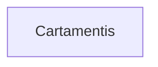

Rules:

```text
The mind map has exactly one root.
The root has no parent.
```

## 7. Add Child

Adds a new topic below an existing topic.

### Before

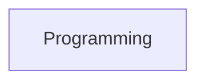

### Operation

```text
AddChild(Programming, ".NET")
```

### After

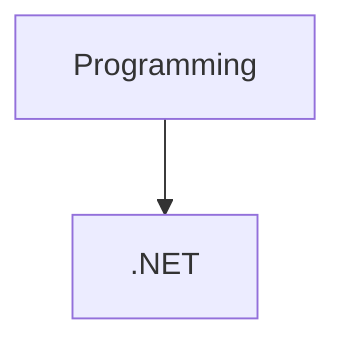

With multiple children:

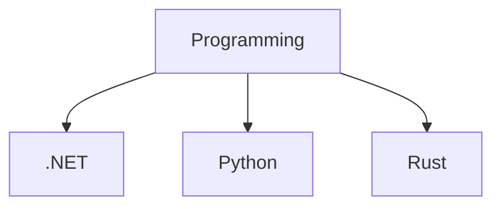

`Programming` automatically stops being a leaf.

## 8. Add Sibling

Adds a topic under the same parent as an existing topic. It is a user-oriented convenience operation that can be expressed internally as adding a child to the current topic's parent.

### Before


### Operation

```text
AddSibling(.NET, "Python")
```

### After

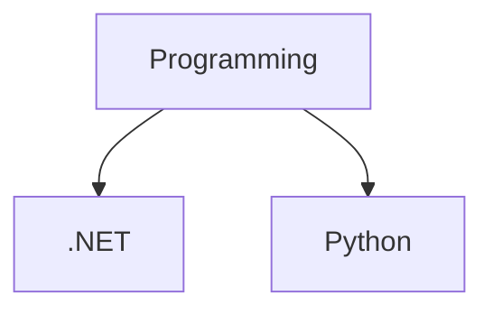

## 9. Remove Leaf

Removes a topic that has no children.

### Before


Operation:

```text
Remove(Python)
```

### After

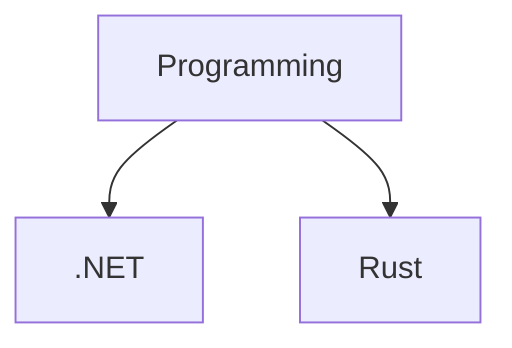

## 10. Remove Subtree

Removes a topic together with all its descendants.

### Before

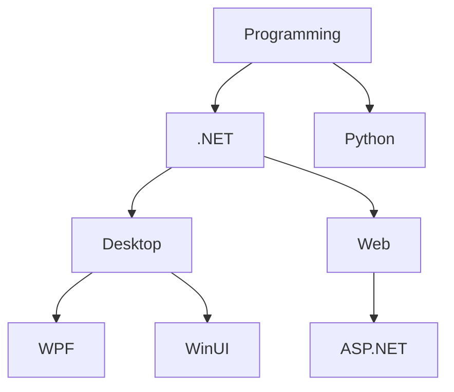

Operation:

```text
RemoveSubtree(Desktop)
```

Removed subtree:

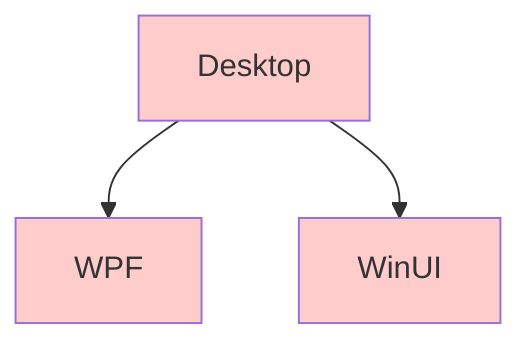

### Result

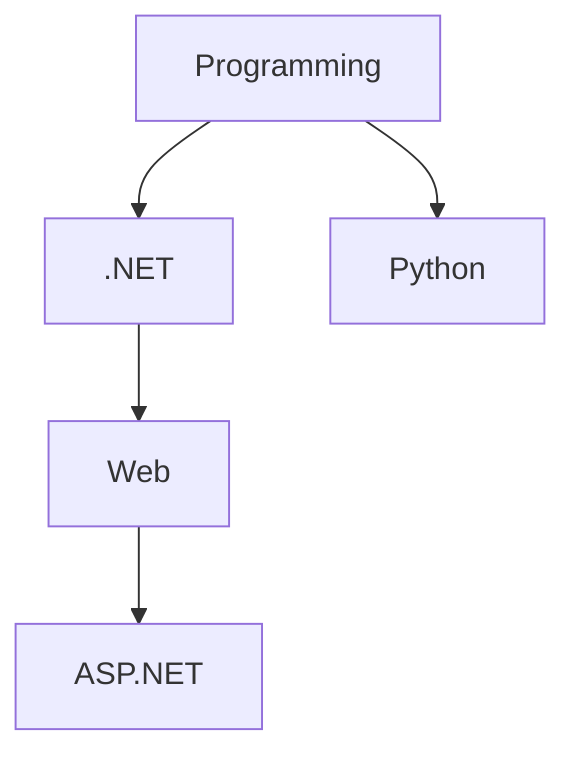

## 11. Move Subtree

Moves a topic and all its descendants under a new parent. This is the core structural operation behind drag and drop.

### Before

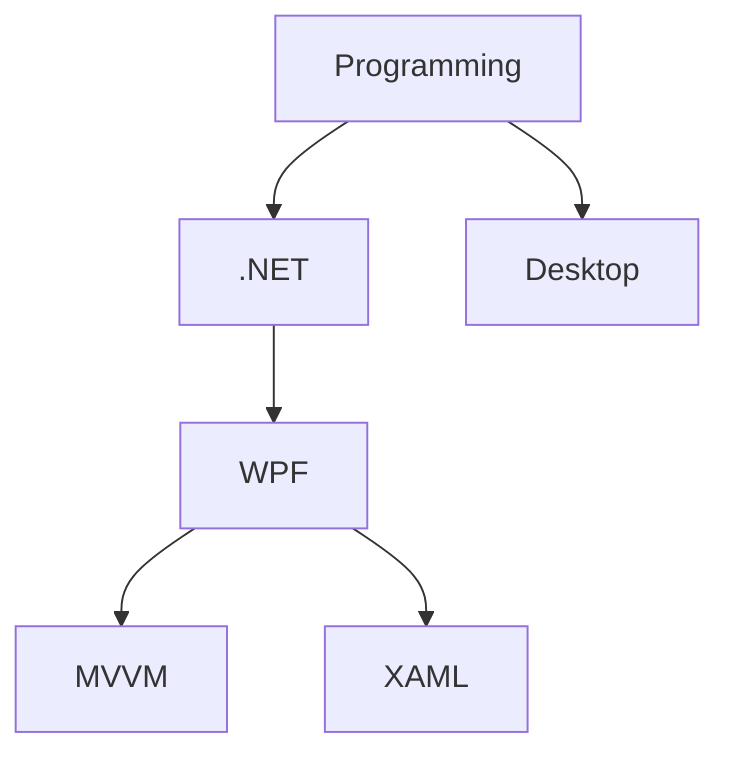

Operation:

```text
MoveSubtree(WPF, Desktop)
```

### After

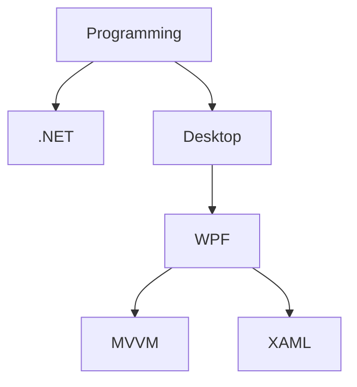

`MVVM` and `XAML` remain descendants of `WPF` and move with it.

## 12. Reparent Topic

Reparenting changes the parent of a topic. Structurally, it is the same operation as moving a subtree, so it does not need to exist as a separate public operation.

### Before

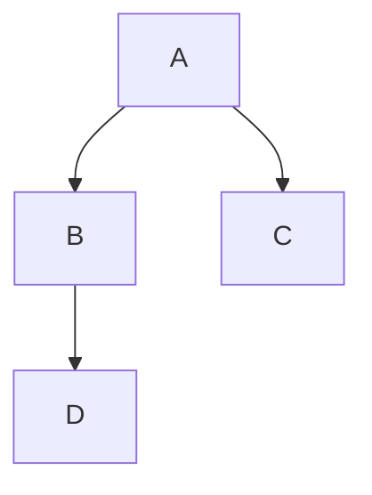

Operation:

```text
MoveSubtree(D, C)
```

### After

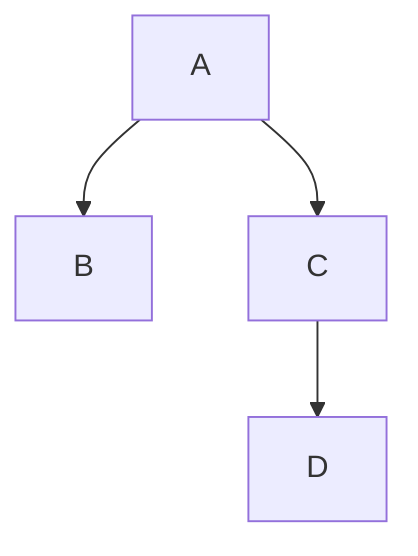

Only one hierarchical relationship changes:

```text
B --> D
```

becomes:

```text
C --> D
```

## 13. Promote

Moves a topic one level toward the root. Its subtree remains attached.

### Before

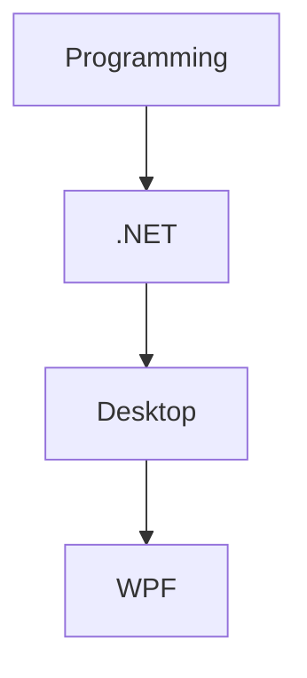

Operation:

```text
Promote(Desktop)
```

### After

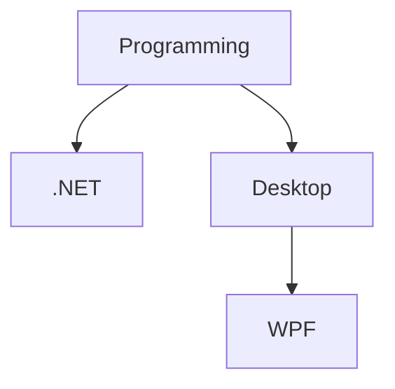

The root cannot be promoted.

## 14. Demote

Moves a topic one level deeper, usually by making it a child of its previous sibling. This operation depends on sibling order.

### Before

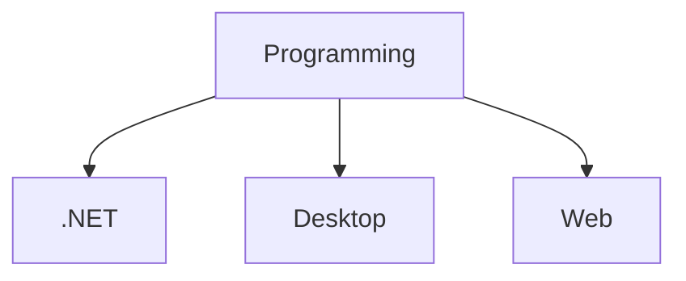

Sibling order:

```text
.NET
Desktop
Web
```

Operation:

```text
Demote(Desktop)
```

### After

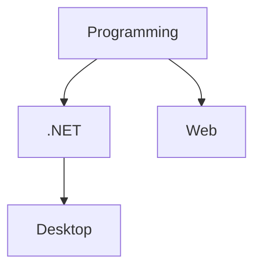

This maps naturally to outline-editor interaction:

```text
Tab       → Demote
Shift+Tab → Promote
```

## 15. Reorder Siblings

Changes the order of topics sharing the same parent without changing their parent-child relationships.

### Initial State

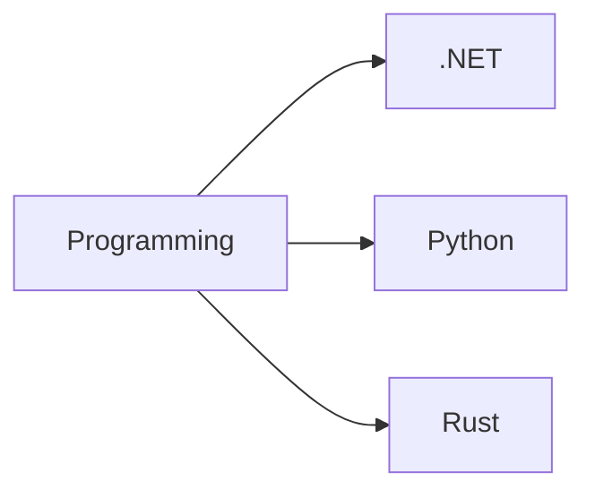

Initial order:

```text
[.NET, Python, Rust]
```

Operation:

```text
MoveBefore(Rust, Python)
```

New order:

```text
[.NET, Rust, Python]
```

### Result

```mermaid
graph LR
    A["Programming"]
    A --> B[".NET"]
    A --> D["Rust"]
    A --> C["Python"]
```

## 16. Clone Subtree

Copies a topic and all its descendants under another parent. Every cloned topic receives a new identity even when its content is identical.

### Before

```mermaid
graph TD
    A["Programming"]
    A --> B["Desktop"]
    A --> C["Web"]

    B --> D["Architecture"]
    D --> E["MVVM"]
    D --> F["DI"]
```

Operation:

```text
CloneSubtree(Architecture, Web)
```

### After

```mermaid
graph TD
    A["Programming"]
    A --> B["Desktop"]
    A --> C["Web"]

    B --> D["Architecture"]
    D --> E["MVVM"]
    D --> F["DI"]

    C --> G["Architecture"]
    G --> H["MVVM"]
    G --> I["DI"]
```

The original and cloned `MVVM` topics are different topics. The same applies to the two `DI` topics.

## 17. Extract Subtree

Creates a new mind map from an existing subtree. The selected topic becomes the root of the new map.

### Input Map

```mermaid
graph TD
    A["Software"]
    A --> B["Programming"]
    A --> C["Architecture"]

    C --> D["DDD"]
    C --> E["Clean Architecture"]

    D --> F["Entity"]
    D --> G["Aggregate"]
```

Operation:

```text
ExtractSubtree(DDD)
```

### New Map

```mermaid
graph TD
    D["DDD"]
    D --> F["Entity"]
    D --> G["Aggregate"]
```

## 18. Traverse

Visits topics in a defined order.

```mermaid
graph TD
    A["A"]
    A --> B["B"]
    A --> C["C"]

    B --> D["D"]
    B --> E["E"]

    C --> F["F"]
```

Depth-first traversal:

```text
A
B
D
E
C
F
```

Breadth-first traversal:

```text
A
B
C
D
E
F
```

## 19. Find Ancestors

Returns the parent, grandparent, and remaining predecessors up to the root.

```mermaid
graph TD
    A["Programming"]
    A --> B[".NET"]
    B --> C["Desktop"]
    C --> D["WPF"]
    D --> E["Binding"]
```

Operation:

```text
Ancestors(Binding)
```

Result:

```text
WPF
Desktop
.NET
Programming
```

Highlighted path:

```mermaid
graph TD
    A["Programming"] --> B[".NET"]
    B --> C["Desktop"]
    C --> D["WPF"]
    D --> E["Binding"]

    style A fill:#fff2cc
    style B fill:#fff2cc
    style C fill:#fff2cc
    style D fill:#fff2cc
    style E fill:#ccffcc
```

## 20. Find Descendants

Returns all topics below the selected topic.

```mermaid
graph TD
    A["Programming"]
    A --> B[".NET"]
    A --> C["Python"]

    B --> D["Desktop"]
    B --> E["Web"]

    D --> F["WPF"]
    D --> G["WinUI"]

    E --> H["ASP.NET"]
```

Operation:

```text
Descendants(.NET)
```

Result:

```text
Desktop
WPF
WinUI
Web
ASP.NET
```

## 21. Find Path to Root

Returns the unique hierarchical path from a selected topic to the root.

```mermaid
graph TD
    A["Programming"]
    A --> B[".NET"]
    B --> C["Desktop"]
    C --> D["WPF"]
    D --> E["Binding"]

    style A fill:#d9eaff
    style B fill:#d9eaff
    style C fill:#d9eaff
    style D fill:#d9eaff
    style E fill:#d9eaff
```

Operation:

```text
GetPathToRoot(Binding)
```

Result:

```text
Binding
→ WPF
→ Desktop
→ .NET
→ Programming
```

This path can also be displayed as a breadcrumb:

```text
Programming / .NET / Desktop / WPF / Binding
```

## 22. Collapse and Expand

Hides or reveals descendants without changing the tree structure.

### Full Structure

```mermaid
graph TD
    A["Programming"]
    A --> B[".NET"]
    A --> C["Python"]

    B --> D["Desktop"]
    B --> E["Web"]

    D --> F["WPF"]
    D --> G["WinUI"]
```

Operation:

```text
Collapse(.NET)
```

### Presentation After Collapse

```mermaid
graph TD
    A["Programming"]
    A --> B[".NET ⊕"]
    A --> C["Python"]
```

The hidden topics still exist:

```text
.NET
├── Desktop
│   ├── WPF
│   └── WinUI
└── Web
```

Collapsed state belongs to presentation state rather than the structural tree model.

## 23. Reject Cycle Creation

Any operation that would make a topic a descendant of itself must be rejected.

### Before

```mermaid
graph TD
    A["A"]
    A --> B["B"]
    B --> C["C"]
    C --> D["D"]
```

Invalid operation:

```text
MoveSubtree(B, D)
```

It would create:

```mermaid
graph TD
    B["B"] --> C["C"]
    C --> D["D"]
    D --> B

    linkStyle 2 stroke:#f00,stroke-width:3px
```

This produces the cycle:

```text
B → C → D → B
```

Before moving a subtree, the new parent must not be the topic itself or any of its descendants.

# Operation Groups

## 24. Structural Mutations

```text
Create Mind Map
Add Child
Add Sibling
Remove Leaf
Remove Subtree
Move Subtree
Promote
Demote
Reorder Siblings
Clone Subtree
Extract Subtree
```

`Reparent Topic` is treated as another name for `Move Subtree`, not as a separate primitive.

## 25. Structural Queries

```text
Is Root
Is Leaf
Get Parent
Get Children
Get Ancestors
Get Descendants
Get Depth
Get Path to Root
Traverse Depth First
Traverse Breadth First
```

## 26. Presentation Operations

```text
Collapse
Expand
Select
Focus
Zoom To
Center On
```

These operations should not modify the hierarchy.

# Tree Invariants

The basic model is protected by the following rules:

```text
1. A mind map has exactly one root.

2. The root has no parent.

3. Every non-root topic has exactly one hierarchical parent.

4. A topic cannot become its own ancestor or descendant.

5. The hierarchical branch structure contains no cycles.

6. There is exactly one hierarchical path from the root to every topic.

7. Sibling order is explicit when it affects layout or editing operations.

8. Moving a topic moves its complete subtree.

9. Cloning creates new topic identities.

10. Associations, if introduced, do not change hierarchical parenthood.
```

A valid rooted mind-map tree:

```mermaid
graph TD
    ROOT["Root"]

    ROOT --> A["A"]
    ROOT --> B["B"]
    ROOT --> C["C"]

    A --> D["D"]
    A --> E["E"]

    B --> F["F"]

    F --> G["G"]
    F --> H["H"]
```

# Example Uses

## 27. Brainstorming

```text
Idea
├── Technology
├── Users
├── Business
└── Risks
```

## 28. Software Architecture

```text
Cartamentis
├── Domain
│  ├── Topic
│  ├── Connection
│  └── Mind Map
├── Presentation
│  ├── WPF
│  └── View Models
└── Infrastructure
   └── Persistence
```

## 29. Problem Analysis

```text
Bug
├── Symptoms
├── Causes
├── Experiments
├── Evidence
└── Solutions
```

## 30. Book Notes

```text
After Virtue
├── Thesis
├── History
├── Virtue
├── Tradition
└── Criticism
```

## 31. Class Design

```text
Topic
├── Identity
├── Content
├── Children
├── Connections
└── Rendering
```

# Final Architectural Direction

Cartamentis should initially treat a mind map as a rooted tree and enforce its invariants strictly. Topics are vertices, hierarchical branches are edges, and leaf status is derived from structure.

The important extension point is the distinction between hierarchical branches and optional associations:

```text
Tree
  ↓
Rooted Tree
  ↓
Tree + Associations
  ↓
Graph
  ↓
Knowledge Graph
```

This approach keeps the first implementation understandable while leaving the domain model open to graph-based exploration. The user can work with a familiar mind-map hierarchy, while the application remains capable of evolving toward richer knowledge structures.
