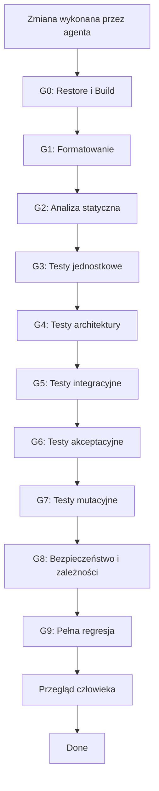
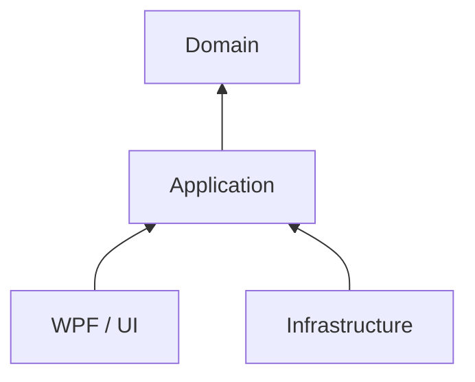

# AI Agent Quality Gates

## Cel dokumentu

Ten dokument definiuje zestaw automatycznych bramek jakości dla zmian tworzonych lub modyfikowanych przez agentów AI. Bramki są wdrażane etapowo wraz ze wzrostem projektu, jego ryzyka i kosztu regresji.

Główna zasada:

> Agent może uznać zadanie za zakończone wyłącznie wtedy, gdy wszystkie aktywne bramki jakości przechodzą bez błędów.

Quality gates nie zastępują przeglądu projektu i decyzji architektonicznych. Tworzą jednak powtarzalny, automatyczny harness ograniczający ryzyko, że agent dostarczy kod, który działa tylko lokalnie, omija wymagania albo pogarsza jakość systemu.

---

## 1. Model bramek jakości



Nie wszystkie bramki muszą być aktywne od początku. Powinny być dodawane w miarę dojrzewania projektu.

---

## 2. Poziomy dojrzałości projektu

| Poziom | Charakter projektu | Obowiązkowe bramki |
|---|---|---|
| L0 — Playground | eksperyment, prototyp, spike | G0–G1 |
| L1 — Small Project | pierwsza logika domenowa | G0–G3 |
| L2 — Growing Project | więcej modułów i współtwórców | G0–G4 |
| L3 — Application | trwałość danych i integracje | G0–G5 |
| L4 — Product | jawne wymagania użytkownika | G0–G6 |
| L5 — Mature | kosztowne regresje i stabilne API | G0–G8 |
| L6 — Production Critical | wysokie ryzyko biznesowe lub techniczne | G0–G9 oraz human approval |

### Zasada wdrażania

Nowa bramka powinna stać się obowiązkowa, gdy koszt błędów, które wykrywa, zaczyna przewyższać koszt jej utrzymania.

---

# 3. Definicje bramek

## G0 — Restore i Build

**Cel:** potwierdzić, że rozwiązanie można odtworzyć i zbudować w czystym środowisku.

### Checklista

- [ ] `dotnet restore` kończy się sukcesem.
- [ ] `dotnet build --no-restore` kończy się sukcesem.
- [ ] Nie występują błędy kompilacji.
- [ ] Agent nie wprowadza nowych ostrzeżeń kompilatora.
- [ ] Build działa z czystego checkoutu.
- [ ] Build nie zależy od niezatwierdzonych plików lokalnych.
- [ ] Build nie wymaga ręcznych kroków niewymienionych w dokumentacji.
- [ ] Agent nie wyłącza ostrzeżeń w celu uzyskania wyniku PASS.

### Przykładowe polecenia

```bash
dotnet restore
dotnet build --no-restore --configuration Release
```

### Kryterium PASS

- exit code równy `0`;
- zero błędów;
- zero nowych ostrzeżeń względem gałęzi bazowej.

---

## G1 — Formatowanie i spójność kodu

**Cel:** wyeliminować przypadkowe różnice formatowania oraz zbędny szum w zmianach.

### Checklista

- [ ] Repozytorium zawiera `.editorconfig`.
- [ ] Kod jest zgodny z konfiguracją formatowania.
- [ ] Zmiana nie zawiera niepowiązanych poprawek formatting-only.
- [ ] Agent nie formatuje całego repozytorium przy lokalnej zmianie.
- [ ] Nie występują nieoczekiwane zmiany kodowania plików i zakończeń linii.

### Przykładowe polecenie

```bash
dotnet format --verify-no-changes
```

### Kryterium PASS

Polecenie nie wykrywa plików wymagających formatowania.

---

## G2 — Analiza statyczna

**Cel:** wykrywać problemy poprawności, nullability, utrzymania i bezpieczeństwa bez uruchamiania aplikacji.

### Rekomendowany zestaw dla .NET

- wbudowane .NET/Roslyn analyzers;
- nullable reference types;
- `TreatWarningsAsErrors`;
- opcjonalnie `StyleCop.Analyzers`;
- opcjonalnie `SonarAnalyzer.CSharp`;
- dodatkowe analizatory właściwe dla wykorzystywanych frameworków.

### Minimalna konfiguracja

```xml
<PropertyGroup>
  <Nullable>enable</Nullable>
  <TreatWarningsAsErrors>true</TreatWarningsAsErrors>
  <AnalysisLevel>latest</AnalysisLevel>
  <EnforceCodeStyleInBuild>true</EnforceCodeStyleInBuild>
</PropertyGroup>
```

### Checklista

- [ ] Brak nowych ostrzeżeń kompilatora i analizatorów.
- [ ] Nullable warnings = `0` dla nowego kodu.
- [ ] Agent nie dodaje `#pragma warning disable` bez uzasadnienia.
- [ ] Agent nie dodaje ogólnych `NoWarn` w plikach projektu.
- [ ] Agent nie obniża `AnalysisLevel`.
- [ ] Agent nie zmienia severity reguły tylko po to, aby przejść gate.
- [ ] Każde nowe suppression jest lokalne, opisane i podlega przeglądowi.
- [ ] Nowy dług techniczny wykryty przez analizator jest rozwiązany albo jawnie zaakceptowany przez człowieka.

### Kryterium PASS

- zero nowych naruszeń;
- konfiguracja analizatorów nie została osłabiona;
- uzasadnione suppressions podlegają osobnemu zatwierdzeniu.

---

## G3 — Testy jednostkowe

**Cel:** weryfikować zachowanie małych jednostek logiki oraz umożliwić bezpieczny refactoring.

### Przykładowy stack .NET

- `xUnit`, `NUnit` albo `MSTest`;
- opcjonalnie `FluentAssertions`;
- biblioteka mocków tylko tam, gdzie podstawienie granicy jest rzeczywiście potrzebne.

### Checklista

- [ ] Nowe zachowanie posiada test jednostkowy, jeśli jego charakter na to pozwala.
- [ ] Poprawka błędu zawiera test odtwarzający regresję.
- [ ] Test regresyjny nie przechodzi przed poprawką.
- [ ] Testy obejmują istotne przypadki brzegowe i błędne dane.
- [ ] Testy są deterministyczne.
- [ ] Testy nie zależą od kolejności wykonania.
- [ ] Testy nie zależą od zegara systemowego, sieci ani systemu plików bez kontrolowanej abstrakcji.
- [ ] Testy sprawdzają zachowanie, a nie przypadkowe szczegóły implementacji.
- [ ] Agent nie usuwa ani nie osłabia istniejących asercji w celu uzyskania PASS.
- [ ] Agent nie oznacza testów jako `Skip`, `Ignore` lub ich odpowiednika.
- [ ] Pełny zestaw testów jednostkowych przechodzi.

### Workflow Red–Green–Refactor

1. **RED:** utwórz lub wskaż test nieprzechodzący z właściwego powodu.
2. **GREEN:** wykonaj minimalną zmianę zapewniającą przejście testu.
3. Uruchom odpowiedni zestaw testów.
4. **REFACTOR:** popraw strukturę bez zmiany zachowania.
5. Ponownie uruchom testy.
6. Uruchom wszystkie aktywne quality gates.

> Red–Green–Refactor opisuje sposób pracy agenta. Quality gates niezależnie sprawdzają rezultat jego pracy.

### Przykładowe polecenie

```bash
dotnet test --no-build --configuration Release
```

---

## G4 — Testy architektury

**Cel:** automatycznie chronić kierunek zależności, granice modułów i przyjęte reguły projektowe.

### Przykładowe narzędzia .NET

- `ArchUnitNET`;
- `NetArchTest`.

### Przykładowy kierunek zależności



Niedozwolone zależności:

```text
Domain          -X-> Infrastructure
Domain          -X-> WPF/UI
Application     -X-> WPF/UI
Application     -X-> konkretne adaptery Infrastructure
```

### Checklista

- [ ] Domain nie zależy od UI.
- [ ] Domain nie zależy od Infrastructure.
- [ ] Application nie zależy od konkretnej technologii UI.
- [ ] Kierunek zależności jest zgodny z przyjętą architekturą.
- [ ] Nowe projekty i assemblies mają jawnie sprawdzane zależności.
- [ ] Niedozwolone zależności namespace są wykrywane automatycznie.
- [ ] Granice modułów oraz dostępność typów są testowane.
- [ ] Reguły nazw i lokalizacji wybranych klas są testowane, jeśli stanowią część architektury.
- [ ] Agent nie zmienia testów architektury, aby zalegalizować wygodne obejście.
- [ ] Dodanie nowego `ProjectReference` podlega kontroli.

### Kryterium PASS

Zero naruszeń aktywnych reguł architektury.

---

## G5 — Testy integracyjne

**Cel:** sprawdzać współpracę komponentów i granice z zasobami zewnętrznymi.

### Typowe obszary

- serializacja i deserializacja;
- zapis i odczyt plików;
- baza danych i migracje;
- komunikacja z usługami zewnętrznymi;
- konfiguracja dependency injection;
- adaptery Infrastructure;
- kompatybilność formatów danych.

### Checklista

- [ ] Krytyczne integracje posiadają test happy path.
- [ ] Sprawdzane są istotne błędy integracji.
- [ ] Testy używają izolowanych zasobów.
- [ ] Dane testowe są czyszczone po wykonaniu.
- [ ] Testy nie zależą od kolejności.
- [ ] Testy nie korzystają przypadkowo z produkcyjnych zasobów.
- [ ] Schemat lub migracje są sprawdzane na czystej instancji.
- [ ] Format danych zapisanych wcześniej pozostaje kompatybilny, jeśli jest to wymagane.
- [ ] Testy są jednoznacznie oznaczone jako integracyjne.
- [ ] Flaky tests blokują awans zmiany, dopóki nie zostaną poprawione lub formalnie odizolowane.

### Przykładowy kontrakt round-trip

```text
Model domenowy
    -> serializacja
    -> trwały zapis
    -> odczyt
    -> deserializacja
    -> równoważny model domenowy
```

### Kryterium PASS

Wszystkie wymagane testy integracyjne przechodzą w powtarzalnym środowisku CI.

---

## G6 — Testy akceptacyjne

**Cel:** weryfikować wymagane zachowanie produktu niezależnie od zastosowanej implementacji.

### Możliwe podejścia

- wykonywalne scenariusze Gherkin, np. z `Reqnroll`;
- testy przez publiczny interfejs warstwy Application;
- testy API;
- kontrolowane testy UI dla najważniejszych ścieżek użytkownika.

### Przykład

```gherkin
Feature: Building a mind map

  Scenario: Adding a child node to a root node
    Given a mind map contains a root node
    When a child node is added to the root
    Then the root has one child
    And the child references the root as its parent
```

### Checklista

- [ ] Każde istotne kryterium akceptacji ma wykonywalny scenariusz.
- [ ] Scenariusze używają języka domenowego.
- [ ] Scenariusze opisują zachowanie, a nie szczegóły techniczne.
- [ ] Testy korzystają z publicznych punktów wejścia systemu.
- [ ] Istnieją scenariusze negatywne dla krytycznych reguł.
- [ ] Agent implementujący funkcję nie zmienia oczekiwań istniejącego scenariusza.
- [ ] Zmiana testu akceptacyjnego wymaga osobnego uzasadnienia i zatwierdzenia.
- [ ] Wszystkie aktywne scenariusze przechodzą przed oznaczeniem zadania jako zakończonego.

### Rozdzielenie odpowiedzialności

```text
Człowiek / wymaganie
        |
        v
Test akceptacyjny należący do harnessu
        |
        v
Agent: RED -> GREEN -> REFACTOR
        |
        v
Niezależne uruchomienie testów akceptacyjnych
```

### Kryterium PASS

Wszystkie wymagane scenariusze przechodzą, a agent nie osłabił oczekiwań.

---

## G7 — Testy mutacyjne

**Cel:** sprawdzać, czy testy rzeczywiście wykrywają zmiany zachowania, a nie tylko wykonują kod.

### Narzędzie dla .NET

- `Stryker.NET`.

### Strategia etapowego wdrażania

#### Etap A — raport informacyjny

- uruchamianie lokalne lub okresowe w CI;
- brak blokowania merge;
- analiza surviving mutants w krytycznej logice domenowej.

#### Etap B — ochrona zmienionego kodu

- mutation score nie może spadać;
- nowe lub zmienione krytyczne zachowanie powinno zabijać odpowiadające mutanty;
- survived mutants w zmienionym kodzie wymagają analizy.

#### Etap C — obowiązkowa bramka

- ustalony próg dla krytycznych modułów;
- brak regresji wyniku względem gałęzi bazowej;
- raport publikowany jako artefakt CI.

### Checklista

- [ ] Mutation testing obejmuje krytyczną logikę domenową.
- [ ] Wynik nie spada względem wartości bazowej.
- [ ] Nowe survived mutants w zmienionym kodzie są przeanalizowane.
- [ ] Testy są poprawiane, jeśli mutant ujawnia brakujące sprawdzenie zachowania.
- [ ] Agent nie dodaje wyjątków tylko w celu podniesienia wyniku.
- [ ] Agent nie wyłącza plików produkcyjnych bez zgody człowieka.
- [ ] Timeouty i równoległość są skonfigurowane tak, aby wynik był stabilny.
- [ ] Equivalent mutants są dokumentowane, a wykluczenia są minimalne i jawne.

### Przykładowe polecenie

```bash
dotnet stryker
```

### Zalecane kryterium początkowe

Zamiast arbitralnego progu dla całego repozytorium:

```text
Mutation score nie może spaść.
Nowy krytyczny kod domenowy nie może pozostawiać nieprzeanalizowanych surviving mutants.
```

---

## G8 — Bezpieczeństwo, sekrety i zależności

**Cel:** ograniczyć ryzyko podatności, wycieku sekretów i niekontrolowanych zmian pakietów.

### Możliwe narzędzia

- raport podatności pakietów .NET;
- GitHub Dependabot;
- GitHub CodeQL;
- secret scanning;
- analizatory bezpieczeństwa właściwe dla platformy.

### Checklista

- [ ] Brak sekretów, tokenów i credentials w repozytorium.
- [ ] Brak nowych krytycznych podatności zależności.
- [ ] Nowa zależność jest uzasadniona.
- [ ] Zależność ma akceptowalną licencję.
- [ ] Agent nie aktualizuje wielu niepowiązanych pakietów przy okazji małej zmiany.
- [ ] Dane wejściowe na granicach systemu są walidowane.
- [ ] Krytyczne dane nie są zapisywane do logów.
- [ ] Deserializacja danych zewnętrznych jest traktowana jako granica bezpieczeństwa.
- [ ] Zmiany w autoryzacji, kryptografii i obsłudze sekretów wymagają human approval.

### Przykładowe polecenie

W nowszych SDK .NET:

```bash
dotnet package list --vulnerable --include-transitive
```

W projektach korzystających ze starszej składni CLI odpowiednikiem może być:

```bash
dotnet list package --vulnerable --include-transitive
```

### Kryterium PASS

- brak sekretów;
- brak niezaakceptowanych podatności;
- brak nieuzasadnionych zmian zależności.

---

## G9 — Pełna regresja i gotowość do merge

**Cel:** upewnić się, że zmiana przechodzi kompletny zestaw kontroli w środowisku zbliżonym do docelowego.

### Checklista

- [ ] Wszystkie wcześniejsze bramki przechodzą.
- [ ] Pełny zestaw testów przechodzi, nie tylko testy wybrane przez agenta.
- [ ] Pipeline działa na czystym środowisku.
- [ ] Artefakt produkcyjny można zbudować.
- [ ] Nie występują niezatwierdzone zmiany publicznego API.
- [ ] Nie występują niezatwierdzone zmiany schematu lub formatu danych.
- [ ] Dokumentacja została zaktualizowana, jeśli zmienił się sposób użycia systemu.
- [ ] Agent przedstawił listę zmienionych plików i skutków zmiany.
- [ ] Ryzyka, ograniczenia i nieuruchomione kontrole zostały jawnie zgłoszone.
- [ ] Zmiana krytycznego harnessu uzyskała zgodę człowieka.

---

# 4. Zasady bezpieczeństwa działania agenta

## Agent MUST

- [ ] Przeczytać instrukcje repozytorium przed zmianą kodu.
- [ ] Określić aktywne quality gates.
- [ ] Pracować w małych, możliwych do zweryfikowania krokach.
- [ ] Dla poprawki błędu najpierw odtworzyć problem testem, jeśli jest to możliwe.
- [ ] Uruchomić testy bezpośrednio związane ze zmianą.
- [ ] Następnie uruchomić pełny wymagany zestaw bramek.
- [ ] Raportować dokładne wyniki wykonanych kontroli.
- [ ] Jawnie wskazać kontrolę, której nie mógł uruchomić.
- [ ] Zatrzymać się i zgłosić problem, gdy przejście gate wymagałoby osłabienia harnessu.

## Agent MUST NOT

- [ ] Usuwać failing tests w celu uzyskania GREEN.
- [ ] Osłabiać asercji bez zmiany zaakceptowanych wymagań.
- [ ] Używać `Skip`, `Ignore` lub podobnego mechanizmu dla problematycznego testu.
- [ ] Samodzielnie zmieniać istniejących kryteriów akceptacji.
- [ ] Dodawać wykluczeń do coverage lub mutation testing w celu poprawienia wyniku.
- [ ] Wyłączać reguł analizatorów w celu przejścia builda.
- [ ] Dodawać szerokiego `#pragma warning disable`.
- [ ] Obniżać progów jakości.
- [ ] Zmieniać testów architektury, aby zalegalizować własne obejście.
- [ ] Modyfikować pipeline CI w celu pominięcia failing gate.
- [ ] Ukrywać nieuruchomionych testów lub błędów środowiska.
- [ ] Uznawać zadania za zakończonego na podstawie częściowego zestawu testów.

---

# 5. Ownership plików i poziomy autonomii

## Agent-owned

Agent może modyfikować w ramach zadania:

- kod produkcyjny we wskazanym zakresie;
- testy jednostkowe;
- prywatne szczegóły implementacji;
- dokumentację bezpośrednio związaną ze zmianą.

## Agent-modifiable, review required

Agent może proponować zmiany, ale powinien je wyróżnić w raporcie:

- publiczne API;
- zależności NuGet;
- schemat bazy danych;
- format serializacji;
- kontrakty integracyjne;
- konfigurację dependency injection;
- granice modułów i projekty solution.

## Harness-owned, explicit approval required

Agent nie powinien samodzielnie zmieniać:

- testów akceptacyjnych definiujących istniejące wymagania;
- testów architektury;
- konfiguracji analizatorów;
- progów coverage i mutation testing;
- wykluczeń z analizy;
- reguł bezpieczeństwa;
- workflow CI/CD;
- plików definiujących instrukcje i ograniczenia agenta.

Przykładowa struktura:

```text
src/                    # agent-owned w zakresie zadania
tests/unit/             # agent-owned
tests/integration/      # agent-modifiable
tests/acceptance/       # harness-owned
tests/architecture/     # harness-owned
quality/                # harness-owned
.github/workflows/      # harness-owned
.editorconfig           # harness-owned
Directory.Build.props   # harness-owned
```

---

# 6. Etapowy plan wdrażania

## Etap 0 — od pierwszego commita

Aktywuj:

- [ ] G0 Restore i Build;
- [ ] G1 Formatowanie;
- [ ] podstawową konfigurację `.editorconfig`;
- [ ] jedno polecenie lokalne uruchamiające cały gate.

Minimalny pipeline:

```text
RESTORE -> BUILD -> FORMAT CHECK
```

## Etap 1 — pierwsza logika domenowa

Dodaj:

- [ ] G2 Analizę statyczną;
- [ ] G3 Testy jednostkowe;
- [ ] nullable reference types;
- [ ] warnings as errors;
- [ ] Red–Green–Refactor jako workflow agenta.

Pipeline:

```text
RESTORE -> BUILD -> FORMAT -> STATIC ANALYSIS -> UNIT TESTS
```

## Etap 2 — podział na warstwy lub moduły

Dodaj:

- [ ] G4 Testy architektury;
- [ ] reguły kierunku zależności;
- [ ] kontrolę nowych `ProjectReference`;
- [ ] review zmian publicznego API.

## Etap 3 — trwałość danych i integracje

Dodaj:

- [ ] G5 Testy integracyjne;
- [ ] kontrolowane zasoby testowe;
- [ ] testy round-trip serializacji;
- [ ] testy kompatybilności formatu;
- [ ] osobne oznaczenie testów integracyjnych.

## Etap 4 — produkt i stabilne wymagania

Dodaj:

- [ ] G6 Testy akceptacyjne;
- [ ] scenariusze dla kluczowych ścieżek;
- [ ] ownership testów akceptacyjnych po stronie harnessu;
- [ ] obowiązkową aktualizację kryteriów przez człowieka.

## Etap 5 — dojrzała baza kodu

Dodaj:

- [ ] G7 Mutation testing jako raport;
- [ ] analizę surviving mutants w zmienionym kodzie;
- [ ] zasadę „mutation score nie może spadać”;
- [ ] stopniowe przekształcenie raportu w twardy gate.

## Etap 6 — projekt produkcyjny

Dodaj:

- [ ] G8 Kontrolę bezpieczeństwa i zależności;
- [ ] secret scanning;
- [ ] analizę podatności zależności;
- [ ] G9 Pełną regresję;
- [ ] wymagany human approval dla zmian wysokiego ryzyka.

---

# 7. Kryteria awansu do kolejnego poziomu

Dodaj kolejną bramkę, jeśli występuje co najmniej jeden z poniższych sygnałów:

- [ ] podobna regresja pojawiła się więcej niż raz;
- [ ] projekt otrzymał kolejny moduł lub warstwę;
- [ ] więcej niż jedna osoba albo agent modyfikuje repozytorium;
- [ ] build i testy zaczynają różnić się między środowiskami;
- [ ] zmiana formatu danych może uszkodzić istniejące pliki użytkownika;
- [ ] publiczne API jest używane przez inny komponent;
- [ ] ręczna weryfikacja zaczyna być powtarzalna i kosztowna;
- [ ] koszt regresji jest istotny biznesowo;
- [ ] agent znajduje obejścia prowadzące formalnie do PASS, ale pogarszające projekt.

---

# 8. Raport końcowy wymagany od agenta

Agent powinien zakończyć zadanie raportem w poniższym formacie:

```markdown
## Change summary

- Cel zmiany:
- Zmienione zachowanie:
- Najważniejsze pliki:

## Quality gates

- [x] Restore
- [x] Build
- [x] Format check
- [x] Static analysis
- [x] Unit tests
- [ ] Architecture tests — nieaktywne na tym poziomie projektu
- [ ] Integration tests — nie dotyczy zmiany
- [ ] Acceptance tests — nieuruchomione; wymagane środowisko UI
- [ ] Mutation tests — tryb raportowy, wynik: ...
- [x] Dependency vulnerability check

## Test results

- Uruchomione polecenia:
- Liczba nieprzechodzących testów: 0
- Nowe lub zmienione testy:

## Risks and deviations

- Nieuruchomione kontrole:
- Znane ograniczenia:
- Zmiany harnessu wymagające review:
```

Agent nie może oznaczyć brakującej kontroli jako PASS. Powinien użyć jednej z wartości:

- `PASS`;
- `FAIL`;
- `NOT APPLICABLE`;
- `NOT RUN`, wraz z powodem.

---

# 9. Przykładowy lokalny quality gate dla .NET

Poniższy skrypt jest punktem startowym. Należy dostosować go do struktury solution i aktywnych narzędzi.

```bash
#!/usr/bin/env bash
set -euo pipefail

dotnet restore
dotnet build --no-restore --configuration Release
dotnet format --verify-no-changes --no-restore
dotnet test --no-build --configuration Release
```

Po aktywacji kolejnych poziomów pipeline powinien osobno uruchamiać:

1. testy jednostkowe;
2. testy architektury;
3. testy integracyjne;
4. testy akceptacyjne;
5. mutation testing;
6. analizę bezpieczeństwa i zależności.

Oddzielne kroki ułatwiają wskazanie, która bramka nie przeszła i dlaczego.

---

# 10. Definition of Done dla zmiany wykonanej przez AI

Zmiana jest zakończona, gdy:

- [ ] zaakceptowane kryteria zostały spełnione;
- [ ] zmiana pozostaje w uzgodnionym zakresie;
- [ ] wszystkie aktywne quality gates mają status PASS;
- [ ] test regresyjny istnieje dla naprawionego błędu, jeśli było to wykonalne;
- [ ] nie osłabiono harnessu jakości;
- [ ] nie dodano niejawnych suppressions ani exclusions;
- [ ] nie wykonano niepowiązanych aktualizacji zależności;
- [ ] ryzyka i pominięte kontrole zostały jawnie wskazane;
- [ ] dokumentacja została uaktualniona, jeśli zmieniły się sposób użycia lub kontrakt;
- [ ] zmiany wysokiego ryzyka otrzymały wymagany human approval.

---

# 11. Najważniejsza reguła

```text
AI może zmieniać rozwiązanie.
AI nie może samodzielnie zmieniać kryteriów, według których rozwiązanie jest oceniane.
```

Celem quality gates nie jest udowodnienie, że kod jest idealny. Ich celem jest stworzenie środowiska, w którym agent nie może łatwo ukryć regresji, osłabić wymagań ani ominąć istotnych ograniczeń architektonicznych.
